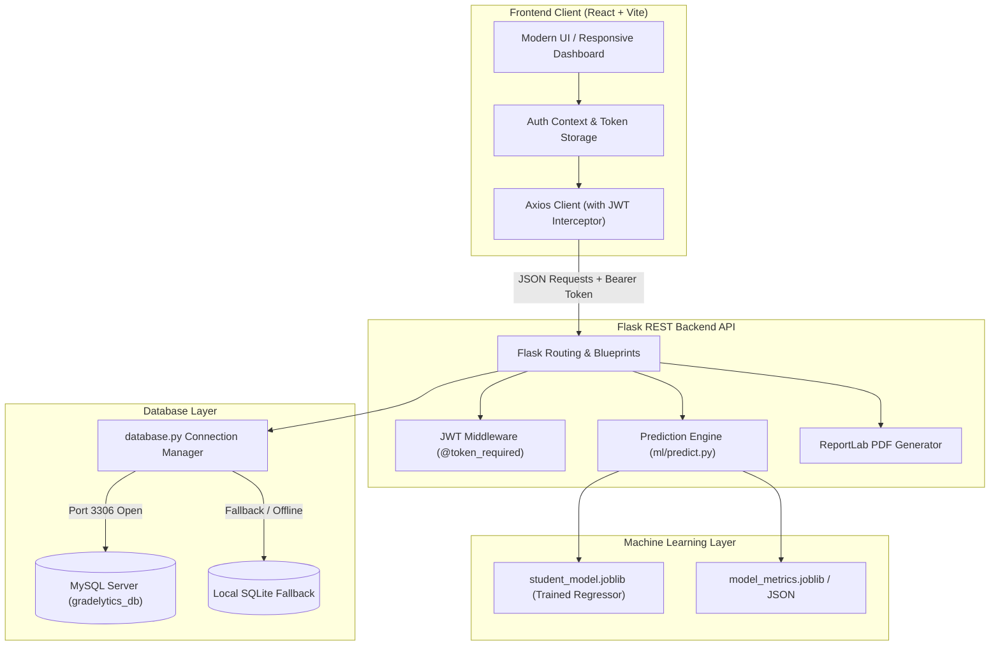

# Gradelytics – AI-Powered Student Performance Prediction System

> **Tagline:** Predict Better. Perform Better.  
> **Degree Project:** BCA Final-Year Academic Capstone Project  
> **Project Type:** Full-Stack Web Application with Machine Learning Integration  

---

## 1. Project Introduction

**Gradelytics** is an end-to-end AI-powered academic performance analytics and prediction system. Developed for academic institutions, educators, and students, the application estimates a student's expected final examination marks based on continuous academic and behavioural parameters. By leveraging genuine machine learning regression algorithms, Gradelytics identifies students who may be academically at risk early in the semester, providing targeted, data-backed recommendations for performance intervention.

---

## 2. Problem Statement

In conventional academic environments, student evaluations are predominantly summative and retrospective:
* Educators identify struggling students only *after* final examination results are declared, when remedial action is no longer possible.
* Crucial formative indicators—such as fluctuating lecture attendance, inconsistent homework submission, low internal assessment scores, and inadequate daily self-study hours—are often evaluated in isolation without integrated predictive analysis.
* Educators lack centralized predictive tools to simulate how changes in student habits (e.g., increasing daily revision hours from 1.5 to 4 hours) could impact examination outcomes.

Gradelytics addresses this challenge by providing continuous formative forecasting, automated risk stratification, and personalized improvement guidance.

---

## 3. Project Objectives

1. **Continuous Marks Estimation:** Predict final examination marks (0–100%) using 7 multidimensional academic and behavioural indicators.
2. **Early Risk Detection:** Automatically categorize students into 4 distinct performance tiers (Excellent, Good, Average, Needs Improvement) and alert faculty to students at risk (<40% or <65% attendance).
3. **Data-Driven Recommendations:** Produce personalized, actionable academic recommendations based strictly on observed student inputs.
4. **Transparent Explainability:** Present model evaluation metrics (MAE, RMSE, R² score) and feature importance without mislabeling regression metrics as classification accuracy.
5. **Secure Cohort Management:** Provide role-based student management, prediction trajectory tracking, CSV bulk cohort import, and downloadable official PDF evaluation reports.

---

## 4. Key Features

* **JWT-Secured Educator Authentication:** Password hashing via Werkzeug (`scikit-learn`/`werkzeug.security`) with secure token expiration and protected REST endpoints.
* **Dynamic Performance Dashboard:** Live aggregate KPIs (Total Students, Total Predictions, Cohort Mean Mark, Students At Risk) calculated directly from MySQL.
* **Interactive Marks Prediction Engine:** Validated 7-feature input form with real-time ML regression inference, visual progress gauge, risk indicators, and personalized recommendations.
* **Cohort Management with Bulk CSV Import:** Complete student CRUD, individual student profile pages, and single-click CSV import with validation and duplicate prevention.
* **Prediction History Archive:** Filterable, searchable, and sortable historical archive of all evaluations with single-click PDF report generation.
* **Visual Analytics & Correlation Reports:** Interactive Recharts visualizations:
  * Category frequency distribution (Bar & Pie)
  * Attendance vs. Predicted Marks scatter plot
  * Daily Study Hours vs. Predicted Marks scatter plot
  * Previous Marks vs. Predicted Marks scatter plot
  * Random Forest feature importance horizontal bar chart
* **Machine Learning Architecture Page:** In-depth explanation of the dataset, preprocessing, algorithm comparison (Linear Regression vs. Random Forest), and a college viva voce Q&A cheat-sheet.
* **Official PDF Report Generation:** Generates downloadable academic evaluation reports with student metadata, prediction results, parameter breakdown, and official disclaimer.

---

## 5. Technology Stack

### Frontend
* **Core Framework:** React 18+ with Vite
* **Routing:** React Router v7
* **HTTP Client:** Axios (with Bearer token interceptor)
* **Data Visualization:** Recharts
* **Icons:** Lucide React
* **Styling:** Custom Academic Design System (Clean, responsive EduTech SaaS layout)

### Backend
* **Runtime & Framework:** Python 3 & Flask RESTful API
* **Data Manipulation:** Pandas & NumPy
* **Machine Learning:** Scikit-learn (Linear Regression, Random Forest Regressor)
* **Model Serialization:** Joblib
* **PDF Report Generation:** ReportLab
* **Authentication:** PyJWT & Werkzeug Security (pbkdf2:sha256)
* **CORS Management:** Flask-CORS

### Database
* **Primary Engine:** MySQL (PyMySQL / Python MySQL Connector)
* **Local Resilient Fallback:** SQLite with identical schema and parameter translation when running on machines without an active MySQL daemon.

---

## 6. System Architecture



---

## 7. Machine Learning Methodology

### Input Features Vector ($X$)
The model consumes strictly 7 features (continuous and discrete academic indicators):
1. `attendance`: Lecture Attendance Percentage (0–100%)
2. `previous_marks`: Prior Examination Marks (0–100)
3. `assignment_marks`: Continuous Homework & Lab Marks (0–100)
4. `study_hours`: Daily Self-Study Hours (0–16 hrs/day)
5. `class_participation`: Classroom Engagement Score (1–10)
6. `internal_marks`: Mid-term Assessment Marks (0–100)
7. `completed_assignments`: Number of completed assignments (0–20)

### Target Variable ($y$)
* `final_exam_marks`: Final Examination Score (0–100%).  
* **Target Leakage Prevention:** Final examination marks are strictly isolated as target $y$ during model fitting and are **never** present in input vector $X$.

### Algorithms Evaluated & Results (Test Set, 20% Split)

| Algorithm | Mean Absolute Error (MAE) | Root Mean Squared Error (RMSE) | R² Score | Decision |
| :--- | :---: | :---: | :---: | :---: |
| **Linear Regression** | **3.758 marks** | **4.630 marks** | **0.843** | **Selected Model (Superior $R^2$)** |
| **Random Forest Regressor** | 4.134 marks | 5.405 marks | 0.787 | Benchmark Comparison |

> **Scientific Metric Distinction:** MAE, RMSE, and R² are continuous regression evaluation metrics. Regression estimates continuous quantities; reporting these metrics as "classification accuracy" is scientifically inaccurate and avoided in Gradelytics.

---

## 8. Database Schema (`gradelytics_db`)

### 1. `users` Table
| Column | Type | Constraints | Description |
| :--- | :--- | :--- | :--- |
| `id` | INT | PRIMARY KEY, AUTO_INCREMENT | Unique educator user ID |
| `full_name` | VARCHAR(150) | NOT NULL | Educator full name |
| `email` | VARCHAR(150) | NOT NULL, UNIQUE | Educator login email |
| `password_hash` | VARCHAR(255) | NOT NULL | Hashed password string |
| `created_at` | TIMESTAMP | DEFAULT CURRENT_TIMESTAMP | Account creation date |
| `updated_at` | TIMESTAMP | AUTO UPDATE | Last update timestamp |

### 2. `students` Table
| Column | Type | Constraints | Description |
| :--- | :--- | :--- | :--- |
| `id` | INT | PRIMARY KEY, AUTO_INCREMENT | Internal primary key |
| `student_id` | VARCHAR(50) | NOT NULL, UNIQUE | University Roll / Register number |
| `full_name` | VARCHAR(150) | NOT NULL | Student's full name |
| `email` | VARCHAR(150) | NOT NULL | Student's institutional email |
| `course` | VARCHAR(100) | NOT NULL | Degree name (e.g., BCA) |
| `semester` | INT | NOT NULL | Current semester (1–6) |
| `attendance` | FLOAT | NOT NULL | Current attendance percentage |
| `previous_marks` | FLOAT | NOT NULL | Baseline examination marks |
| `created_by` | INT | FOREIGN KEY (users.id) | Educator who registered student |
| `created_at` | TIMESTAMP | DEFAULT CURRENT_TIMESTAMP | Record creation timestamp |

### 3. `predictions` Table
| Column | Type | Constraints | Description |
| :--- | :--- | :--- | :--- |
| `id` | INT | PRIMARY KEY, AUTO_INCREMENT | Prediction run ID |
| `student_id` | INT | FOREIGN KEY (students.id) | Linked student ID |
| `user_id` | INT | FOREIGN KEY (users.id) | Linked evaluator ID |
| `attendance` | FLOAT | NOT NULL | Observed attendance |
| `previous_marks` | FLOAT | NOT NULL | Prior exam score |
| `assignment_marks` | FLOAT | NOT NULL | Assignment score |
| `study_hours` | FLOAT | NOT NULL | Revision hours per day |
| `class_participation` | FLOAT | NOT NULL | Engagement rating |
| `internal_marks` | FLOAT | NOT NULL | Mid-term score |
| `completed_assignments` | INT | NOT NULL | Assignments submitted |
| `predicted_marks` | FLOAT | NOT NULL | ML continuous estimate |
| `performance_category` | VARCHAR(50) | NOT NULL | Performance band |
| `created_at` | TIMESTAMP | DEFAULT CURRENT_TIMESTAMP | Evaluation date |

---

## 9. Local Installation & Execution

### Prerequisites
* Python 3.10+ (Tested on Python 3.14)
* Node.js v18+ (Tested on Node.js v24)
* Optional: MySQL Server / XAMPP (Port 3306)

### Option A: Quick One-Click Launch (Windows)
Double-click `run.bat` in the project root. This automatically starts both the Flask backend and the React frontend in two separate terminals.

### Option B: Manual Step-by-Step Launch

#### 1. Backend Setup
```bash
cd backend

# Install dependencies
pip install -r requirements.txt

# (Optional) Retrain ML Model & regenerate metrics
python ml/train_model.py

# (Optional) Seed demo students and predictions
python database/seed_demo.py

# Start Flask backend server
python app.py
```
*Backend runs on `http://127.0.0.1:5000`*

#### 2. Frontend Setup
```bash
cd frontend

# Install Node modules
npm install

# Start Vite development server
npm run dev
```
*Frontend runs on `http://localhost:5173`*

---

## 10. Default Demonstration Credentials

| Role | Email | Password |
| :--- | :--- | :--- |
| **Demo Educator** | `educator@gradelytics.com` | `admin123` |

*Alternatively, click "Use Demo Evaluator Credentials" on the login screen or register a new educator account.*

---

## 11. REST API Reference

| Endpoint | Method | Auth | Description |
| :--- | :---: | :---: | :--- |
| `/api/auth/register` | POST | Public | Register new educator account |
| `/api/auth/login` | POST | Public | Authenticate and obtain JWT token |
| `/api/auth/me` | GET | Bearer | Retrieve authenticated user profile |
| `/api/auth/profile` | PUT | Bearer | Update user profile full name |
| `/api/auth/change-password` | PUT | Bearer | Verify current password and set new password |
| `/api/dashboard` | GET | Bearer | Fetch aggregate KPIs, distribution, and risk alerts |
| `/api/students` | GET | Bearer | List cohort students with search & semester filters |
| `/api/students` | POST | Bearer | Register new student profile |
| `/api/students/<id>` | GET | Bearer | Get student details and all past prediction runs |
| `/api/students/<id>` | PUT | Bearer | Update student profile details |
| `/api/students/<id>` | DELETE | Bearer | Delete student and cascade remove evaluations |
| `/api/students/import-csv` | POST | Bearer | Bulk import students via CSV file or JSON array |
| `/api/predictions` | POST | Bearer | Run ML regression inference and record prediction |
| `/api/predictions` | GET | Bearer | List all evaluations with search, category & date filter |
| `/api/predictions/<id>` | GET | Bearer | View complete input features and analysis breakdown |
| `/api/predictions/<id>` | DELETE | Bearer | Delete prediction record |
| `/api/predictions/<id>/pdf` | GET | Bearer | Stream official ReportLab PDF evaluation report |
| `/api/analytics` | GET | Bearer | Fetch cohort distributions, scatters, and feature weights |
| `/api/model-info` | GET | Bearer | Fetch ML metadata, MAE/RMSE/R² metrics, and viva notes |
| `/api/health` | GET | Public | Healthcheck probe |

---

## 12. Deployment Guide

### Frontend Deployment (Vercel)
1. Push project to a GitHub repository.
2. In Vercel, import the repository and set **Root Directory** to `frontend`.
3. Framework Preset: **Vite**.
4. Set Environment Variable:
   * `VITE_API_URL`: Your deployed Flask backend URL (e.g., `https://gradelytics-api.onrender.com`).
5. Deploy.

### Backend Deployment (Render / Railway)
1. In Render, create a new **Web Service** pointing to the repository.
2. Set **Root Directory** to `backend`.
3. Build Command: `pip install -r requirements.txt`.
4. Start Command: `gunicorn app:app` or `python app.py`.
5. Add Environment Variables:
   * `SECRET_KEY`: `<secure-random-key>`
   * `JWT_SECRET_KEY`: `<secure-jwt-key>`
   * `DB_HOST`, `DB_USER`, `DB_PASSWORD`, `DB_NAME`: Your managed MySQL database credentials (e.g., PlanetScale / Aiven / CleverCloud).
   * `CORS_ORIGINS`: Your Vercel frontend URL.

---

## 13. College Viva Voce Defense Guide

1. **Why is Gradelytics suitable for a BCA Final-Year Project?**  
   It demonstrates full-stack competence (React, Flask, MySQL REST APIs) combined with real Applied Data Science (EDA, regression model comparison, evaluation metrics, and target leakage prevention).
2. **Why evaluate with both Linear Regression and Random Forest?**  
   To contrast a standard parametric baseline (Linear Regression) against an ensemble tree-based non-linear regressor (Random Forest). In our test dataset, Linear Regression achieved an $R^2$ of 0.843, illustrating strong linear relationships among weighted formative assessments.
3. **What is the meaning of the Disclaimer?**  
   Machine Learning outputs are statistical estimates based on historical correlation. Academic institutions must treat predictions as decision-support alerts for proactive mentoring, not guaranteed outcomes.

---

*Gradelytics &copy; 2026. Built for BCA Final-Year Academic Project Demonstration.*
